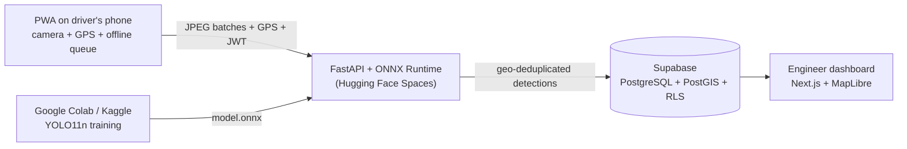

# RoadGuard Qro

**Passive road-infrastructure auditing for municipalities, powered by Computer Vision.**

RoadGuard Qro is an open-source B2G (Business-to-Government) Micro-SaaS for public works departments.
Smartphones mounted on the dashboards of existing municipal fleets (garbage trucks, patrol cars) run a
Progressive Web App that captures pavement frames during normal routes. A Convolutional Neural Network
detects potholes and cracks, classifies their severity, geolocates them and publishes them on an
interactive dashboard so engineers can prioritize the asphalt budget with data instead of complaints.

> **Zero-cost rule:** every component runs on a free tier that requires **no credit card**, both during
> development and in commercial operation.

---

## How it works



1. **Capture** – the PWA takes a frame every ~20 m of travel (not every N seconds), crops the road
   region, resizes to 640 px, compresses to JPEG and queues it in IndexedDB.
2. **Upload** – frames are sent in small batches with retries and exponential backoff; an optional
   *Wi-Fi only* mode uses zero mobile data.
3. **Inference** – FastAPI runs a quantized YOLO11n CNN (ONNX Runtime, CPU) and computes a severity score.
4. **Deduplication** – PostGIS merges detections of the same damage class within 8 m into a single
   `pothole` entity; detections from different vehicles act as confirmations.
5. **Dashboard** – engineers filter, validate and track repairs on a live map and export CSV reports.

## Tech stack

| Layer | Technology | Free tier |
|---|---|---|
| Sensor | Driver's smartphone camera + GPS | – |
| Dataset | RDD2022 (CC BY-SA 4.0) + permissively licensed Kaggle pothole datasets | – |
| Training | Ultralytics YOLO11n (PyTorch) on Google Colab / Kaggle Notebooks | Free GPU |
| Model serving | FastAPI + ONNX Runtime (INT8) in Docker on Hugging Face Spaces | CPU basic (2 vCPU / 16 GB) |
| Database & Auth | Supabase (PostgreSQL, PostGIS, Row Level Security, Realtime, Storage) | Free plan |
| Frontend | Next.js (static export) + Tailwind CSS, MapLibre GL + OpenFreeMap | Vercel Hobby / Cloudflare Pages |
| CI/CD | GitHub Actions | Unlimited for public repos |

## Repository layout

```
roadguard-qro/
├── ml/                  # Data preparation, classical baseline, YOLO training and ONNX export notebooks
├── backend/             # FastAPI inference API + Dockerfile + tests
├── frontend/            # Next.js PWA (/capture) and engineer dashboard (/dashboard)
├── supabase/            # SQL migrations: schema, PostGIS, RLS policies, functions
├── .github/workflows/   # CI, deployment and keep-alive jobs
└── docs/                # Architecture, CNN justification, datasets, privacy, deployment
```

## Documentation

- [Architecture & decision log](docs/ARCHITECTURE.md)
- [Why a CNN? (academic justification)](docs/CNN_JUSTIFICATION.md)
- [Datasets & attribution](docs/DATASETS.md)
- [Privacy](docs/PRIVACY.md)
- [Implementation phases & control gates](docs/ROADMAP.md)

## Project status

| Phase | Deliverable | Status |
|---|---|---|
| 0 – Repository & Documentation | AGPL-3.0, architecture log, CNN justification, roadmap | ✅ Complete |
| 1 – Data & ML Pipelines | RDD2022 conversion, classical baseline, YOLO11n & ONNX export | ✅ Complete |
| 2 – Supabase PostGIS Database | Multi-tenant schema, RLS, spatial deduplication procedure, seed | ✅ Complete |
| 3 – FastAPI Backend | ONNX CPU runner, 503 semaphore backoff, PostGIS RPC, Docker | ✅ Complete |
| 4 – Next.js PWA & Dashboard | Driver PWA (bottom 60% ROI), MapLibre GL OpenFreeMap, simulator | ✅ Complete |
| 5 – CI/CD & Cloud Deployment | GitHub Actions test & build, Hugging Face Space sync, keep-alive | ✅ Complete |

## Deployment Guide

Detailed step-by-step instructions for zero-cost deployment are documented in [docs/DEPLOYMENT_GUIDE.md](docs/DEPLOYMENT_GUIDE.md).

## License

RoadGuard Qro is licensed under the **GNU Affero General Public License v3.0** – see [LICENSE](LICENSE).
This lets the project use Ultralytics YOLO free of charge, including commercially, and gives
municipalities full transparency over the software they operate. Dataset attributions are listed in
[docs/DATASETS.md](docs/DATASETS.md).
