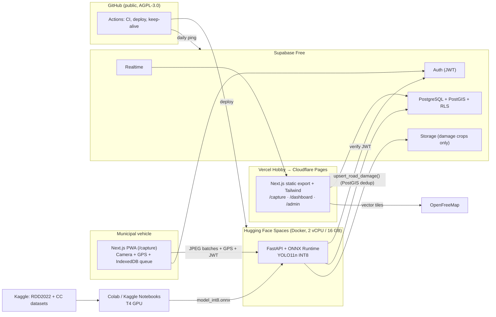

# Architecture & Decision Log

## 1. System overview

## 2. Decision log

| # | Decision | Chosen | Rejected | Rationale |
|---|---|---|---|---|
| D1 | Project & model license | **AGPL-3.0 open source** + **Ultralytics YOLO11n** | Ultralytics Enterprise license (paid) · YOLOX / SSD (Apache-2.0) | Ultralytics is free under AGPL when the whole project is open source, including commercial use. Open source is an advantage in GovTech (auditability, no vendor lock-in). AGPL SaaS businesses (Grafana, Plausible, Cal.com) prove the model. YOLO11n is by far the most practical detector to train on free GPUs. |
| D2 | Backend hosting | **Hugging Face Spaces** (Docker, free CPU basic) | Google Cloud Run (requires a credit card) · Railway (no permanent free tier) | No credit card → zero billing risk. 2 vCPU / 16 GB RAM is more capacity than Cloud Run's free tier for this workload. Fallback: Render free (Docker, no card). |
| D3 | Frontend hosting | Next.js **static export** → Vercel Hobby (academic) → **Cloudflare Pages** (commercial) | Vercel Pro (paid) | Vercel Hobby forbids commercial use; Cloudflare Pages allows it for free. No server functions are needed (Supabase + FastAPI), so the same build runs on both. |
| D4 | Maps | **MapLibre GL JS + OpenFreeMap** | Google Maps / Mapbox (usage-billed) · tile.openstreetmap.org (heavy use forbidden) | No API key, no usage limits, commercial use allowed. |
| D5 | Datasets | **RDD2022 (CC BY-SA 4.0)** + Kaggle pothole datasets licensed **CC0 / CC BY / CC BY-SA** only | Any *NonCommercial* dataset | NC datasets would force retraining or licensing before commercialization. |
| D6 | Training GPU | **Google Colab** + **Kaggle Notebooks** as backup (~30 GPU h/week) | Paid GPUs | Kaggle has the datasets pre-mounted and rescues training when Colab quota runs out. |
| D7 | Driver authentication | Email + password **created by the municipality admin** | Magic links | Supabase's built-in SMTP is heavily rate-limited. Optional SMTP later: Brevo free (300 emails/day). |
| D8 | Local data labeling | **Label Studio** (open source, self-hosted) with model pre-labeling | Roboflow free (public datasets) | Free and keeps city imagery private. |
| D9 | CI/CD & keep-alive | **GitHub Actions** | – | Unlimited minutes on public repos. Daily ping keeps Supabase (7-day pause) and the Space (48 h sleep) awake. |
| D10 | Swappable model | Backend only depends on an **ONNX file + post-processor** | Coupling backend to PyTorch/Ultralytics | The model can be replaced with an Apache-2.0 detector without rewriting the API. Docker image stays ~350 MB. |

## 3. Domain model

| Entity | Purpose |
|---|---|
| `municipalities` | Tenants of the SaaS. Every other row is scoped by `municipality_id` (RLS). |
| `profiles` | One per Supabase Auth user; role `driver`, `engineer` or `admin`. |
| `vehicles` | Fleet units (garbage truck, patrol car, other). |
| `route_sessions` | One driving shift: start/end, km, frames sent/discarded. |
| `detections` | Raw model output per frame (idempotent by client-generated `frame_id`). |
| `road_damages` | Physical damage entity produced by geo-deduplication of detections (≤ 8 m, same class). |

Damage classes (RDD2022 codes): `D00` longitudinal crack · `D10` transverse crack ·
`D20` alligator crack · `D40` pothole.

Damage lifecycle: `reported → confirmed → validated → in_repair → repaired` (or `dismissed`).
A damage becomes `confirmed` automatically when detected by ≥ 2 distinct vehicles.

## 4. Frame capture strategy

| Parameter | Value |
|---|---|
| Trigger | Every **20 m** travelled (Haversine); fallback every 3 s when the device reports no speed |
| Suppression | `speed < 8 km/h` or GPS `accuracy > 25 m` → no capture |
| Region of interest | Bottom **60 %** of the frame (pavement) |
| Resolution | **640 px** wide |
| Encoding | JPEG quality **0.6** (~25 KB) |
| Quality filter | Mean brightness in [40, 220] and Laplacian variance above a calibrated threshold |
| Upload | Batches of **10 frames or every 45 s**, whichever comes first |
| Queue | IndexedDB, max 500 frames; oldest dropped when full |
| Retries | Exponential backoff 2 s → 5 min, honours `Retry-After` |
| Modes | Real-time (mobile data, default) · Wi-Fi only (per municipality) |

**Data budget** (8 h shift, ~80 km): ~3,000 frames × 25 KB ≈ **75 MB/day** (vs. ~1.9 GB/day for a
naive 1-frame-every-3-s full-resolution approach). Wi-Fi-only mode: 0 MB of mobile data.

**Server capacity:** INT8 inference ≈ 0.15 s/frame on 2 vCPU → ~21,000 frames/h. One vehicle
produces ~375 frames/h, so a single free Space serves ~25 active vehicles with a 50 % safety margin.
Client queues absorb peaks; the API answers `503 + Retry-After` when saturated.

## 5. Free-tier limits and mitigations

| Service | Limit | Mitigation |
|---|---|---|
| HF Spaces CPU basic | 1 instance, 2 vCPU, sleeps after 48 h idle | Semaphore + 503/Retry-After + client queue + daily keep-alive |
| Supabase database | 500 MB | Store detections, never frames; `pg_cron` retention |
| Supabase storage | 1 GB | Only ~15 KB WebP damage crops (~65k crops) + retention |
| Supabase egress | 5 GB / month | Small crops, paginated dashboard queries |
| Supabase inactivity | Pauses after 7 days | Daily keep-alive from GitHub Actions |
| Vercel Hobby | Non-commercial only | Move the same static build to Cloudflare Pages |
