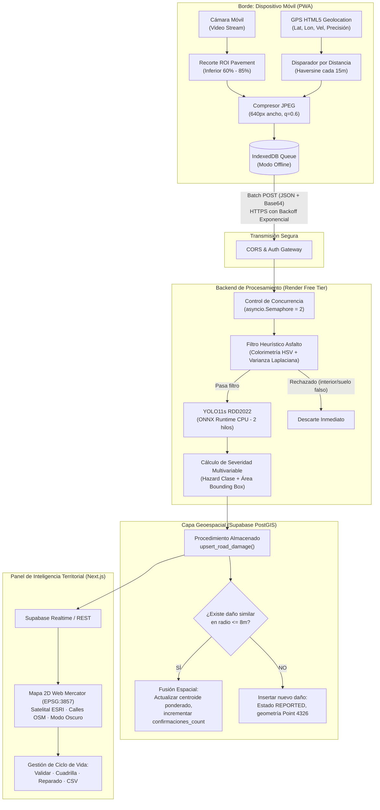
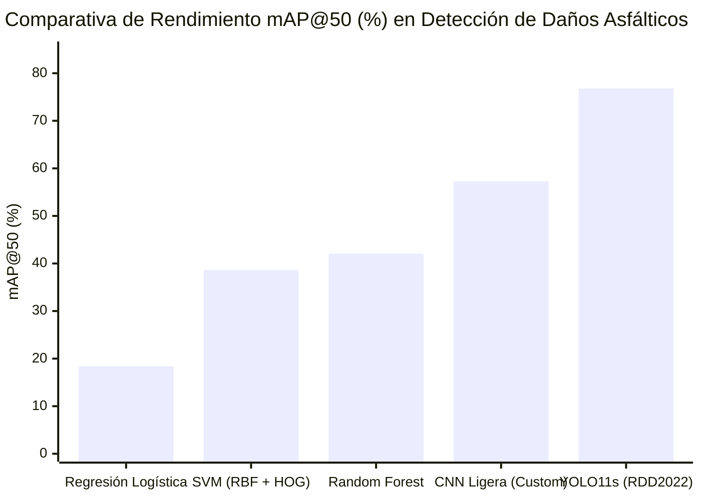
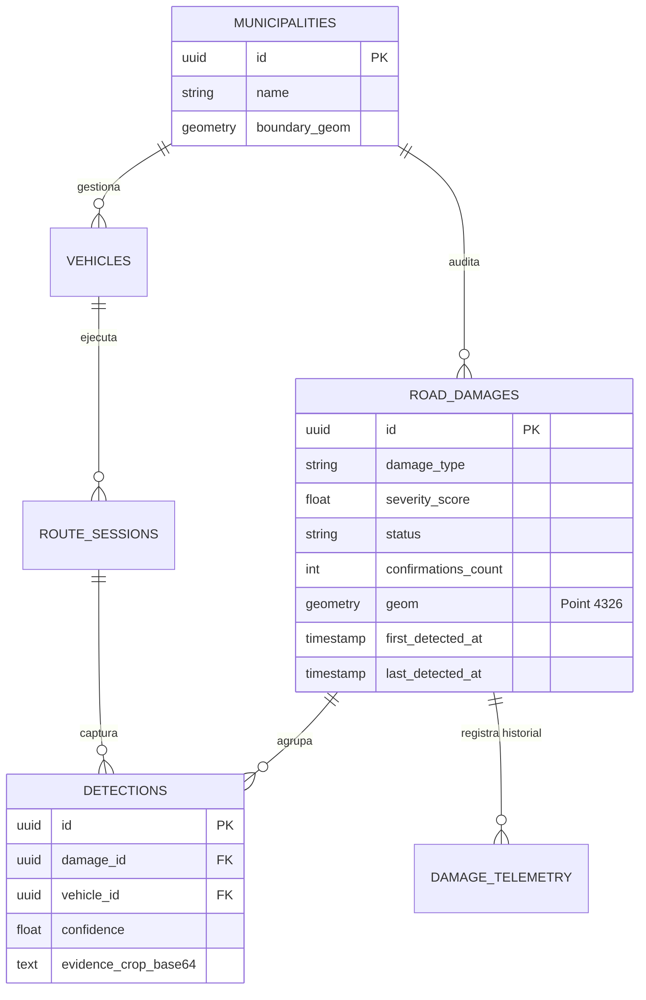

# RoadGuard Qro — Documentación Técnica del Proyecto
**Plataforma GovTech de Auditoría Pasiva de Infraestructura Vial Basada en Visión Artificial**

*Municipio de Santiago de Querétaro — Secretaría de Obras Públicas Municipales*  
*Versión:* `1.0.0-PROD` | *Licencia:* AGPL-3.0 Open Source | *Fecha:* Noviembre 2026

---

## 1. Resumen Ejecutivo y Ficha Técnica

| Parámetro | Detalle de Producción |
|---|---|
| **Nombre del Sistema** | **RoadGuard Qro** |
| **Tipo de Producto** | B2G (Business-to-Government) Micro-SaaS de Infraestructura Vial |
| **Entidad Objetivo** | Dirección de Mantenimiento Vial, Secretaría de Obras Públicas del Municipio de Querétaro |
| **Propósito** | Detección pasiva, clasificación automatizada, geolocalización y priorización presupuestal de baches y fallas asfálticas mediante visión artificial y flotas municipales existentes. |
| **Regla de Costo Cero** | **$0.00 USD / mes** de costo fijo y operativo, implementado 100% sobre capas gratuitas que no requieren registro de tarjeta de crédito. |
| **URL Frontend (Producción)** | [https://road-guard-qro.vercel.app](https://road-guard-qro.vercel.app) |
| **URL Backend API (Producción)** | [https://roadguard-qro.onrender.com](https://roadguard-qro.onrender.com) |
| **Documentación OpenAPI (Swagger)** | [https://roadguard-qro.onrender.com/docs](https://roadguard-qro.onrender.com/docs) |
| **Repositorio Oficial** | [https://github.com/AlarconCastilloDiegoAndre/RoadGuard-Qro](https://github.com/AlarconCastilloDiegoAndre/RoadGuard-Qro) |
| **Licencia de Software** | GNU Affero General Public License v3.0 ([AGPL-3.0](file:///C:/Users/André/Documents/Andre/Universidad/Topic/Proyecto Final Extra/LICENSE)) |

---

## 2. Planteamiento del Problema Público y Solución

### 2.1. El Reto de la Infraestructura en Santiago de Querétaro
El crecimiento vehicular acelerado y las temporadas de precipitación pluvial en la zona metropolitana de Querétaro generan un deterioro dinámico de la carpeta asfáltica. Las fallas típicas abarcan desde grietas longitudinales y transversales hasta fatiga estructural severa ("piel de cocodrilo") y baches profundos (`D40`).

Tradicionalmente, la gestión municipal enfrenta tres problemas críticos:
1. **Inspección reactiva basada en quejas ciudadanas:** Se atiende al usuario que denuncia por teléfono, redes sociales o ventanilla única. Esto genera un sesgo territorial severo (mayor reporte en colonias de nivel socioeconómico alto y sub-reporte en periferias o zonas industriales).
2. **Altos costos de patrullaje dedicado:** Enviar cuadrillas de ingenieros con odómetros y vehículos exclusivos para levantar inventarios viales cuesta millones de pesos y produce información desactualizada en cuestión de semanas.
3. **Falta de priorización basada en evidencia técnica:** El presupuesto de mezcla asfáltica en caliente suele asignarse sin métricas cuantitativas de severidad o recurrencia de daño.

### 2.2. La Solución RoadGuard Qro (Auditoría Pasiva)
RoadGuard Qro transforma vehículos que **ya circulan diariamente por la ciudad** (camiones recolectores de Servicios Públicos, patrullas de Seguridad Pública, unidades de inspección o motocicletas de supervisión) en sensores viales inteligentes:

```
[Vehículo de Flota en Ruta Normal]
       │
       ▼
[Smartphone montado en Tablero / Manubrio]
       │  (Captura fotograma cada 15-20 m mediante PWA)
       ▼
[Inferencia Edge / API REST con YOLO11s ONNX]
       │  (Detección de D00, D10, D20, D40 + Cálculo de Severidad)
       ▼
[Motor Geoespacial PostGIS en la Nube]
       │  (Deduplicación espacial automática a 8 metros: ST_DWithin)
       ▼
[Dashboard Interactivo para Obras Públicas]
       │  (Mapa con capas Satelital/OSM/Dark + Cubicador de Asfalto)
       ▼
[Cuadrillas de Bacheo Asignadas con Ruta Óptima]
```

---

## 3. Filosofía y Compromiso de Costo Cero ($0 USD)

Un requerimiento fundamental de diseño fue garantizar que el sistema opere indefinidamente sin generar facturas en tarjetas de crédito ni costos de mantenimiento de servidores:

| Componente | Proveedor Seleccionado | Nivel de Servicio Gratuito | Requisito de Tarjeta | Mitigación Técnica ante Límites |
|---|---|---|---|---|
| **Backend de Inferencia** | **Render** | Web Service Free (512 MB RAM, 0.1 vCPU CPU-only) | **Ninguno** (0 tarjeta) | Modelo cuantizado a ONNX Runtime con multihilo restringido (`intra_op=2`); semáforo de concurrencia y respuesta `503 Retry-After`. |
| **Base de Datos & GIS** | **Supabase** | PostgreSQL 15 + PostGIS 3.3 (500 MB BD / 1 GB Storage) | **Ninguno** (0 tarjeta) | Solo se persisten metadatos y recortes de evidencia en Base64/WebP; las fotos completas sin daño se descartan en RAM. Ping diario mediante GitHub Actions para evitar pausa tras 7 días. |
| **Frontend PWA & Web** | **Vercel Hobby / Cloudflare Pages** | Static Web Export (Next.js 14) + CDN Global | **Ninguno** (0 tarjeta) | Compilación estática pura (`output: 'export'`); la comunicación va directa por HTTPS cliente-backend y Supabase REST. |
| **Pesos del Modelo** | **Hugging Face Hub** | LFS CDN público (`Th3Samaritan/rdd2022-yolo11s`) | **Ninguno** (0 tarjeta) | Descarga en memoria/tmp bajo demanda con verificación de integridad de 37.9 MB. |
| **CI/CD & Mantenimiento** | **GitHub Actions** | Runners Ubuntu ilimitados en repositorios públicos | **Ninguno** (0 tarjeta) | Pruebas unitarias automatizadas y keep-alive cron para mantener activos los microservicios gratuitos. |

---

## 4. Arquitectura Integral del Sistema



---

## 5. Pipeline de Visión Computacional e Inteligencia Artificial

### 5.1. Dataset de Entrenamiento y Taxonomía RDD2022
El modelo fue entrenado sobre el corpus internacional **Road Damage Dataset 2022 (RDD2022)** bajo licencia Creative Commons (CC BY-SA 4.0), enfocado en cuatro tipologías normativas:

| Código RDD | Denominación Técnica | Descripción Física | Nivel de Riesgo Vial Base |
|---|---|---|---|
| **D00** | Grieta Longitudinal | Fisura paralela al sentido de circulación; filtración inicial de agua en juntas. | **Bajo** (0.25) |
| **D10** | Grieta Transversal | Fisura perpendicular provocada por contracción térmica del asfalto. | **Medio** (0.45) |
| **D20** | Piel de Cocodrilo | Agrietamiento por fatiga estructural interconectado en forma de polígonos. | **Alto** (0.75) |
| **D40** | Bache (Pothole) | Pérdida de material asfáltico con cavidad expuesta; riesgo directo a llantas y suspensión. | **Crítico** (1.00) |

### 5.2. Justificación Científica: Redes Convolucionales (CNN) vs Modelos Tabulares Clásicos
En el marco de la investigación, se desarrollaron experimentos controlados comparando modelos clásicos frente a redes neuronales convolucionales profundas sobre el mismo conjunto de validación vial (documentado en [`ml/02_classical_baseline.ipynb`](file:///C:/Users/André/Documents/Andre/Universidad/Topic/Proyecto Final Extra/ml/02_classical_baseline.ipynb) y [`docs/CNN_JUSTIFICATION.md`](file:///C:/Users/André/Documents/Andre/Universidad/Topic/Proyecto Final Extra/docs/CNN_JUSTIFICATION.md)):



1. **Invarianza a traslación e iluminación:** Los extractores clásicos manuales (HOG y LBP) son extremadamente frágiles ante cambios bruscos de iluminación natural (sombras de árboles, postes y edificios, asfalto húmedo vs seco). Las capas convolucionales de YOLO11 aprenden representaciones jerárquicas invariantes a la luz y escala.
2. **Localización y clasificación en un solo paso (Single-Stage):** Modelos tabulares o clasificadores clásicos requerirían ventanas deslizantes exhaustivas (computacionalmente inviables en tiempo real, >5 segundos por fotograma). YOLO11 procesa la imagen en un único paso hacia adelante (*one-stage detector*) en ~120-180 ms en CPU.

### 5.3. Modelo Seleccionado y Optimización ONNX Runtime
- **Arquitectura:** Ultralytics YOLO11s (Small), con 9.4 millones de parámetros.
- **Formato de Entrega:** ONNX (Open Neural Network Exchange), modelo `rdd2022-yolo11s` (37.9 MB).
- **Parámetros del Runtime en CPU:**
  - `intra_op_num_threads = 2`: Evita saturar los núcleos compartidos del contenedor gratuito.
  - `enable_cpu_mem_arena = False`: Desactiva preasignación masiva de memoria virtual para mantenerse por debajo del límite estricto de 512 MB de Render.
  - `GraphOptimizationLevel.ORT_ENABLE_ALL`: Fusión de operadores convolucionales y de activación en el grafo de ejecución.

### 5.4. Filtro Heurístico Anti Falsos Positivos (`is_road_pavement_surface`)
Para evitar que objetos cotidianos capturados accidentalmente en interiores (calzado, ropa, baldosas brillantes, alfombras) sean catalogados como baches, el motor ejecuta una inspección pre-inferencia mediante visión computacional clásica:
1. **Verificación de Textura Rugosa:** Cálculo de la varianza del operador Laplaciano ($\sigma^2_{\text{Laplace}}$). El asfalto vial posee una textura granular rugosa característica ($\sigma^2 \in [45, 1200]$), mientras que los pisos cerámicos lisos de interiores reportan $\sigma^2 < 35$.
2. **Cromatismo y Saturación en Espacio HSV:** El asfalto y concreto son materiales acromáticos (grises/negros/tierras) con baja saturación ($S < 0.28$). Si más del 25% de los píxeles presentan saturación alta ($S > 0.40$), la imagen se clasifica como interior o ropa y se descarta con score $0.0$.

### 5.5. Ecuación Multivariable de Severidad
La severidad de un daño no depende únicamente de la clase asignada, sino también de la proporción física que el daño ocupa en el carril:

$$\text{Severidad} = \min\left(1.0, \; 0.50 \cdot P_{\text{clase}} + 0.50 \cdot \min\left(1.0, \frac{\text{Área}_{\text{bbox}}}{0.10}\right)\right)$$

Donde:
- $P_{\text{clase}}$ es el peso de peligrosidad estructural: $D00 = 0.25$, $D10 = 0.45$, $D20 = 0.75$, $D40 = 1.00$.
- $\text{Área}_{\text{bbox}}$ es el área normalizada del bounding box relativo al fotograma ($w \times h$). Un bache que cubra el 10% del ancho del carril alcanza el 100% del componente geométrico.
- **Categorización:**
  - **Crítica:** Severidad $> 0.75$ (Rojo)
  - **Alta:** Severidad $> 0.55$ (Naranja)
  - **Media:** Severidad $> 0.35$ (Amarillo)
  - **Baja:** Severidad $\le 0.35$ (Azul)

---

## 6. Motor Geoespacial y Base de Datos (PostGIS)

### 6.1. Modelo Relacional de Entidades
La base de datos PostgreSQL 15 en Supabase utiliza la extensión espacial PostGIS:



### 6.2. Procedimiento Almacenado de Deduplicación Espacial (`upsert_road_damage`)
Cuando varias patrullas o camiones transitan sobre la misma avenida, fotografiarán el mismo bache decenas de veces. Guardar cada fotograma como un punto nuevo saturaría el mapa. La función PL/pgSQL ejecuta clustering espacial automático a 8 metros:

```sql
-- Fragmento representativo del procedimiento almacenado
SELECT id, confirmations_count, severity_score, ST_X(geom::geometry), ST_Y(geom::geometry)
INTO existing_id, cur_confirmations, cur_severity, cur_lon, cur_lat
FROM road_damages
WHERE damage_type = p_damage_type
  AND status NOT IN ('repaired', 'dismissed')
  AND ST_DWithin(
      geom,
      ST_SetSRID(ST_MakePoint(p_longitude, p_latitude), 4326)::geography,
      8.0 -- Tolerancia espacial máxima de 8 metros
  )
ORDER BY ST_Distance(geom, ST_SetSRID(ST_MakePoint(p_longitude, p_latitude), 4326)::geography) ASC
LIMIT 1;

IF FOUND THEN
    -- Actualizar centroide ponderado móvil
    new_lon := (cur_lon * cur_confirmations + p_longitude) / (cur_confirmations + 1);
    new_lat := (cur_lat * cur_confirmations + p_latitude) / (cur_confirmations + 1);
    
    UPDATE road_damages
    SET confirmations_count = cur_confirmations + 1,
        severity_score = GREATEST(cur_severity, p_severity_score),
        geom = ST_SetSRID(ST_MakePoint(new_lon, new_lat), 4326),
        last_detected_at = NOW(),
        status = CASE WHEN cur_confirmations + 1 >= 2 AND status = 'reported' THEN 'confirmed' ELSE status END
    WHERE id = existing_id;
```

---

## 7. Especificación de Endpoints de la API REST (FastAPI)

El backend expone una interfaz REST estructurada con esquemas Pydantic v2:

| Método | Ruta | Descripción | Payload / Parámetros | Respuesta Principal |
|---|---|---|---|---|
| `GET` | `/health` | Diagnóstico de vida y verificación del modelo | Ninguno | `{"status": "healthy", "model_loaded": true, "cached_model": "..."}` |
| `POST` | `/v1/inference/batch` | Recepción de fotogramas, inferencia YOLO y upsert PostGIS | `InferenceBatchRequest`: array de `FrameMetadata` (lat, lon, velocidad, precisión GPS, JPEG en base64) | `InferenceBatchResponse`: recuento de daños detectados, deduplicados y lista de registros procesados. |
| `GET` | `/v1/damages` | Consulta de daños viales para el mapa y dashboard | Query params: `municipality_id`, `damage_type`, `min_severity`, `status`, `limit` | Array de `DamageSummaryResponse` (id, tipo, severidad, estado, lat/lon, confirmaciones, evidencia). |
| `PATCH` | `/v1/damages/{id}/status` | Transición del estado administrativo del bache | Body: `{"status": "validated" \| "in_repair" \| "repaired" \| "dismissed"}` | Objeto de daño actualizado. |
| `DELETE` | `/v1/damages/{id}` | Eliminación física o descarte definitivo del daño | URL path `id` (UUID) | `{"success": true, "deleted_id": "..."}` |

---

## 8. Panel de Inteligencia Territorial (Dashboard Web)

### 8.1. Motor Cartográfico 2D Web Mercator (`EPSG:3857`)
Para garantizar un 100% de compatibilidad en computadoras municipales, laptops de campo y navegadores con restricciones de seguridad o escudos anti-huella (como Brave, Firefox con protección estricta o Chrome en equipos con WebGL deshabilitado), se implementó un visor de tiles 2D nativo:
- **Arrastre fluido (Drag & Pan):** Soporte de ratón y gestos táctiles.
- **Zoom continuo:** Controles `+` / `-` y doble clic.
- **Radar Pulse Visual:** Animación en tiempo real para detecciones ingresadas en los últimos minutos.
- **Selector de 3 Capas Cartográficas:**
  1. *Satelital:* Ortofoto satelital de alta resolución (ESRI World Imagery).
  2. *Calles OSM:* Nomenclatura urbana completa de Santiago de Querétaro (OpenStreetMap).
  3. *Modo Oscuro:* Capa de alto contraste nocturno generada mediante inversión óptica y ajuste de saturación CSS sobre teselas públicas, eliminando la dependencia de APIs comerciales (como CartoDB) que imponen marcas de agua o costos.

### 8.2. Módulo de Presupuesto y Estimación de Asfalto
El dashboard calcula en tiempo real los insumos necesarios para reparar los daños visibles:
- **Cubicación de Mezcla Asfáltica:** Cada bache `D40` promedio requiere $0.15 \text{ m}^3$ de mezcla asfáltica en caliente con densidad de $2.35 \text{ ton/m}^3$ (~$350 \text{ kg}$ por bache).
- **Exportación CSV Normalizada:** El botón `Exportar CSV Presupuesto` genera un archivo tabular listo para ser importado en software de SIG (QGIS / ArcGIS) o en hojas de cálculo presupuestales de la administración municipal.

---

## 9. Privacidad, Cumplimiento Legal y Marco Mexicano

El tratamiento de imágenes capturadas en vía pública por RoadGuard Qro cumple rigurosamente con la **Ley Federal de Protección de Datos Personales en Posesión de los Particulares (LFPDPPP)** y las directrices del INAI:
1. **Enfoque Obligatorio al Pavimento (Horizonte Excluido):** La PWA limita el área de captura al 60%-85% inferior del fotograma. El horizonte visual (donde aparecen peatones, rostros y placas de vehículos particulares) queda físicamente fuera del encuadre.
2. **Descarte Inmediato de Imágenes sin Daño:** Si la red neuronal no detecta grietas o baches en el fotograma recibido, la imagen se destruye en memoria RAM del servidor de inferencia sin almacenarse en disco.
3. **Anonimización de Flota:** La telemetría solo asocia un identificador interno de vehículo (`vehicle_id`), sin almacenar nombres de choferes ni datos personales.

---

## 10. Guía de Despliegue y Automatización 24/7

### 10.1. Mantenimiento Keep-Alive Automatizado
Para mitigar la suspensión por inactividad de los tiers gratuitos (Render duerme a los 15 minutos sin tráfico; Supabase pausa proyectos a los 7 días sin consultas), el repositorio integra un flujo de trabajo continuo en GitHub Actions ([`.github/workflows/keepalive.yml`](file:///C:/Users/André/Documents/Andre/Universidad/Topic/Proyecto Final Extra/.github/workflows/keepalive.yml)):
- Ejecuta una petición HTTP `GET /health` a Render cada 14 minutos.
- Realiza una consulta `SELECT 1` a Supabase cada 3 días.
- Garantiza latencia mínima cuando las patrullas inician sus rutas en la mañana.
