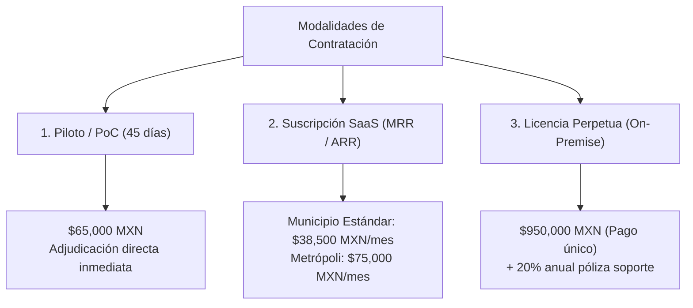
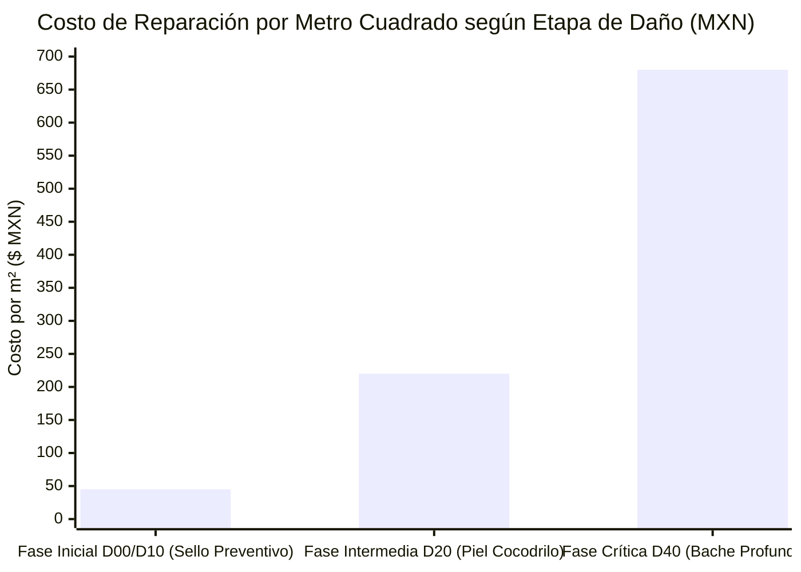

# RoadGuard Qro — Dossier Comercial y Catálogo de Precios B2G
**Plataforma de Inteligencia Artificial para la Auditoría Pasiva y Optimización Presupuestal de Infraestructura Vial**

*Documento confidencial para directores de obra pública, tesoreros municipales y concesionarias carreteras.*  
*Edición:* 2026 / 2027 | *Moneda:* Pesos Mexicanos (MXN) y Dólares Americanos (USD)

---

## 1. Resumen Ejecutivo (El Valor para la Administración Pública)

En los municipios de México, el mantenimiento vial representa uno de los mayores dolores de cabeza operativos y políticos:
- **El 70% de las quejas ciudadanas** en atención ciudadana y redes sociales están vinculadas a baches, desniveles y pavimento destruido.
- **Millones de pesos al año** se pierden por demandas de indemnización por responsabilidad patrimonial del Estado ante llantas reventadas y suspensiones rotas.
- **El presupuesto de bacheo se ejerce a ciegas:** las cuadrillas salen a tapar baches donde "la gente grita más fuerte", no donde técnicamente es más urgente o rentable intervenir.

**RoadGuard Qro** resuelve esto de raíz transformando la flota que el municipio **ya tiene circulando** (camiones de basura, patrullas de policía, camionetas de inspección o motocicletas de supervisión) en una red continua de escaneo vial con Inteligencia Artificial.

```
       CERO INVERSIÓN EN VEHÍCULOS DEDICADOS
       CERO HARDWARE COSTOSO O IMPORTADO
  100% VISIBILIDAD DE CADA METRO DE ASFALTO EN TIEMPO REAL
```

A través de un smartphone convencional montado en el parabrisas o manubrio, el sistema detecta baches (`D40`), grietas por fatiga (`D20`) y fisuras tempranas (`D00`/`D10`), los ubica en un mapa interactivo con precisión métrica y calcula exactamente **cuántas toneladas de mezcla asfáltica se requieren** para licitar y reparar con base en datos reales.

---

## 2. Comparativa de Mercado: ¿Por qué RoadGuard es 10x más eficiente?

| Criterio de Comparación | Vehículo Auscultador Láser (ARAN / Hawkeye) | Cuadrillas Manuales con Libreta / Odómetro | **RoadGuard Qro (Nuestra Solución)** |
|---|---|---|---|
| **Costo por Levantamiento** | $1,800 a $3,500 MXN por kilómetro | ~$180,000 MXN/mes en nómina y combustible | **Fracción del costo (SaaS mensual sin costo por km)** |
| **Frecuencia de Actualización** | 1 vez cada 1 o 2 años (desactualizado en meses) | Esporádica, subjetiva y con sesgo humano | **Diaria y continua (auditoría pasiva)** |
| **Tiempo de Despliegue** | 3 a 6 meses de licitación y calibración | Semanas de capacitación de personal | **72 horas (PWA en teléfonos existentes)** |
| **Hardware Requerido** | Camioneta con equipo láser de >$350,000 USD | Camionetas, odómetros, libretas, cámaras | **Smartphones convencionales Android o iOS** |
| **Deduplicación Inteligente** | No aplica | Se duplican reportes del mismo bache decenas de veces | **Algoritmo geoespacial PostGIS a 8 metros automático** |
| **Evidencia para Licitación** | Reportes técnicos en PDF estáticos | Bitácoras en papel o Excel desordenados | **Dashboard web interactivo + Exportación CSV en 1 clic** |

---

## 3. Catálogo de Modelos de Contratación y Precios

Hemos estructurado esquemas flexibles adaptados a las modalidades de compra del sector público en México (adquisiciones directas, arrendamiento de software o gasto de inversión en capital).



---

### Modalidad A: Suscripción Mensual / Anual (SaaS en la Nube)
*Recomendada para la administración municipal: incluye infraestructura en la nube, actualizaciones continuas de la IA y soporte técnico sin comprometer partidas de inversión fija.*

#### 1. Plan Piloto / Validación Inicial (45 Días de Prueba de Campo)
Ideal para iniciar sin fricción y convencer a Cabildo y Obras Públicas con resultados reales en las principales arterias de la ciudad.
- **Inversión Única:** **$65,000 MXN + IVA** (~$3,500 USD).
- **Alcance:**
  - Habilitación de 3 a 5 unidades de supervisión / patrullas.
  - Levantamiento de hasta **250 kilómetros** de red vial primaria (ej. Av. 5 de Febrero, Bernardo Quintana, Constituyentes, etc.).
  - Acceso total al Dashboard web durante 45 días.
  - Entrega de **Reporte Ejecutivo de Auditoría Vial** con cubicación de asfalto y priorización de puntos críticos.
  - *Bonificación:* Si el municipio contrata el plan anual antes de concluir el piloto, se abona el 100% de esta cuota al contrato anual.

#### 2. Plan Municipio Estándar (Recomendado para ciudades medianas / municipios metropolitanos)
- **Inversión Mensual:** **$38,500 MXN + IVA / mes** (~$2,100 USD/mes).
- **Facturación Anual:** **$462,000 MXN + IVA / año** (descuento del 10% por pago anual anticipado: **$415,800 MXN + IVA**).
- **Incluye:**
  - Hasta **15 vehículos activos simultáneos** en ruta.
  - Kilómetros auditados **ilimitados**.
  - Almacenamiento y procesamiento en la nube con deduplicación espacial continua.
  - Cuentas ilimitadas para ingenieros y directores en el Dashboard web.
  - Módulo de cálculo de mezcla asfáltica en caliente y exportación CSV.
  - Actualizaciones del modelo de IA (detección de nuevas tipologías de daño).
  - Soporte técnico remoto y garantía de operatividad 99.5%.

#### 3. Plan Metropolitano / Nivel Estatal
Diseñado para capitales grandes, zonas metropolitanas conurbadas o Secretarías de Infraestructura del Gobierno del Estado.
- **Inversión Mensual:** **$75,000 MXN + IVA / mes** (~$4,100 USD/mes).
- **Facturación Anual:** **$810,000 MXN + IVA / año** (pago anticipado).
- **Incluye:**
  - Hasta **40 vehículos activos simultáneos**.
  - Soporte para múltiples delegaciones municipales o regiones estatales independientes con permisos segmentados.
  - Integración vía API REST directa con sistemas SIG corporativos (ArcGIS Server, QGIS, bases de datos Oracle/PostgreSQL del municipio).
  - Capacitación presencial semestral a cuadrillas y supervisores.
  - Servidor dedicado con alta disponibilidad y respaldo diario automático.

---

### Modalidad B: Venta Completa de Licencia Perpetua (CapEx / On-Premise)
*Para dependencias que por reglas presupuestales de obra pública o soberanía de datos exijan ser propietarias de la solución instalada en su propio centro de datos o nube municipal (AWS/Azure/GCP del gobierno).*

- **Costo de Licencia Perpetua:** **$950,000 MXN + IVA** (~$52,000 USD, pago único).
- **Póliza Anual de Mantenimiento y Actualizaciones (SLA):** **$190,000 MXN + IVA / año** (20% del valor de la licencia, requerida a partir del segundo año).
- **Entregables de la Licencia Completa:**
  1. **Despliegue Llave en Mano:** Instalación y configuración completa de la infraestructura (frontend Next.js, API FastAPI, contenedores Docker y base de datos PostGIS) en la nube o servidores físicos del cliente.
  2. **Código Fuente y Modelo de IA:** Entrega de pesos del modelo cuantizado ONNX y acceso al repositorio del sistema.
  3. **Capacitación y Transferencia Técnica:** Taller presencial de 16 horas para personal de TI y Dirección de Obras Públicas.
  4. **Garantía y Soporte Correctivo:** Cobertura de 12 meses contra defectos y soporte técnico especializado.

---

### Modalidad C: Concesionarias Carreteras y Autopistas de Cuota
*Para operadores privados de infraestructura (ej. Pinfra, IDEAL, RCO, Aleatica, Autopista Querétaro-Irapuato, etc.) que deben cumplir con estándares de conservación del contrato de concesión.*

- **Esquema por Kilómetro Concesionado:** **$350 MXN + IVA por kilómetro / mes**.
- *Ejemplo para un tramo de 120 km:* **$42,000 MXN + IVA / mes**.
- Incluye auditoría semanal con las camionetas de auxilio vial y supervisión de la propia autopista.

---

## 4. Retorno de Inversión (ROI) para el Municipio de Querétaro

Un municipio del tamaño de Querétaro destina anualmente entre **$80 y $150 millones de pesos** al programa de conservación y bacheo. La implementación de RoadGuard genera ahorros cuantificables inmediatos:



### 1. Ahorro por Prevención Oportuna (80% de reducción de costo)
- Reparar una grieta longitudinal o transversal (`D00`/`D10`) a tiempo mediante **calafateo y riego de sello preventivo** cuesta aproximadamente **$45 MXN por metro lineal**.
- Si esa misma grieta no se atiende, la filtración pluvial colapsa la base en menos de 6 semanas, convirtiéndose en un bache profundo (`D40`) cuya demolición, reposición de base y carpeta en caliente cuesta **$680 MXN por metro cuadrado**.
- **Impacto estimado:** Al detectar 2,000 fallas en fase temprana antes de temporada de lluvias, el municipio ahorra más de **$1.2 millones de pesos** directos en mezcla asfáltica.

### 2. Eliminación de Duplicidad y Auditoría de Contratistas
- En esquemas tradicionales, un contratista privado de bacheo cobra por "metro cuadrado intervenido", pero el municipio no tiene forma humana de verificar si taparon el bache correcto o si la reparación duró más de un mes.
- Con el **historial temporal y fotográfico de RoadGuard**, la supervisión confirma en pantalla si el daño desapareció (`status: repaired`) o si volvió a colapsar, evitando pagar estimaciones fraudulentas.

### 3. Blindaje ante Demandas de Responsabilidad Patrimonial
- En Querétaro, una sola demanda por daños severos a vehículos o accidentes en motocicleta puede costarle al erario municipal entre **$30,000 y $250,000 MXN**.
- RoadGuard documenta fecha y hora de detección, y genera la orden de trabajo con trazabilidad legal de debida diligencia.

> **Conclusión del ROI:** Con un costo anual de suscripción de **$415,800 MXN**, el sistema **se paga solo en menos de 90 días** con el simple ahorro de mezcla asfáltica y la optimización de rutas de cuadrillas.

---

## 5. Proceso de Implementación (Garantía de 72 Horas)

No requerimos meses de consultoría ni obras civiles para comenzar a operar:

```
Día 1: Configuración de la Nube y Cuentas Municipales
       - Alta del tenant municipal en el sistema.
       - Configuración del mapa base de Querétaro con límites oficiales.
       - Creación de credenciales para ingenieros y cuadrillas.

Día 2: Montaje Físico y Calibración
       - Instalación de soportes antivibración en 5 a 15 vehículos seleccionados.
       - Verificación de permisos de cámara y GPS en los teléfonos.
       - Sesión de capacitación operativa de 45 minutos a los choferes.

Día 3: Inicio de Captura y Datos en Vivo
       - La flota sale a sus rutas habituales (recolección, patrullaje, inspección).
       - El Dashboard comienza a recibir detecciones, fotos y baches confirmados.
       - Entrega del primer corte cartográfico al Director de Obras Públicas.
```

---

## 6. Facilidad de Adquisición para Gobierno (Marco Legal Mexicano)

Para los departamentos de compras, tesorería y contraloría municipal, RoadGuard ofrece esquemas con estricto apego a la normatividad:

- **Adjudicación Directa (Plan Piloto de $65,000 MXN):**
  - Se encuentra muy por debajo de los topes de adjudicación directa establecidos por la Ley de Adquisiciones, Enajenaciones, Arrendamientos y Contratación de Servicios del Estado de Querétaro.
  - Puede procesarse mediante orden de compra inmediata en un plazo de **3 a 5 días hábiles**.
- **Contrato de Servicios Tecnológicos / Arrendamiento de Software (SaaS):**
  - No genera activo fijo que deba ser inventariado ni depreciado por Contabilidad Gubernamental.
  - Se clasifica en la partida presupuestal de servicios informáticos y licencias de software (Capítulo 3000).
- **Facturación CFDI 4.0:** 100% deducible y en regla con el SAT, con desglose de IVA y descripción clara del servicio tecnológico.

---

## 7. Niveles de Servicio (SLA) y Garantía Técnica

| Parámetro | Compromiso de Servicio |
|---|---|
| **Disponibilidad del Dashboard (Uptime)** | 99.5% de disponibilidad anual garantizada. |
| **Tiempo de Respuesta ante Incidencias Críticas** | Menor a 2 horas (atención prioritaria vía WhatsApp y llamada telefónica). |
| **Tiempo de Respuesta para Soporte Rutinario** | Menor a 8 horas hábiles vía correo electrónico. |
| **Respaldo de Datos** | Respaldos diarios automáticos con redundancia geográfica. |
| **Soberanía y Privacidad de la Información** | Toda la información y fotografías son propiedad exclusiva del Municipio de Querétaro. |

---

## 8. Siguientes Pasos para Iniciar

1. **Agendar Demo Ejecutiva (20 minutos):** Presentación en vivo del sistema con datos reales de la ciudad de Querétaro en pantalla completa.
2. **Firma del Convenio Piloto (45 días):** Arranque inmediato con 3 a 5 unidades municipales.
3. **Revisión de Resultados con el Presidente Municipal o Secretario:** Presentación del mapa de calor y el ahorro presupuestal proyectado.

---

### Contacto Comercial y Dirección Técnica

- **Líder de Proyecto / Desarrollador:** Diego André Alarcón Castillo
- **Correo Electrónico:** `contacto@roadguard-qro.mx` / `alarconcastillodiegoandre@gmail.com`
- **Repositorio Oficial:** [github.com/AlarconCastilloDiegoAndre/RoadGuard-Qro](https://github.com/AlarconCastilloDiegoAndre/RoadGuard-Qro)
- **Plataforma en Vivo:** [road-guard-qro.vercel.app](https://road-guard-qro.vercel.app)
- **Ubicación:** Santiago de Querétaro, Qro., México
