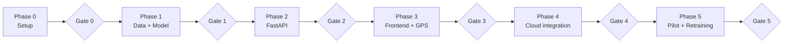

# Roadmap — Phases & Control Gates

Each phase ends with a **control gate**: measurable proof-of-concept criteria that must be met
before moving to the next phase.

## Phase 0 — Setup
Free accounts (no credit card): GitHub, Kaggle, Google (Colab), Hugging Face, Supabase, Vercel,
Cloudflare. Public AGPL repository, PostGIS enabled, empty Docker Space, first Vercel deploy.

**Gate 0:** Colab detects a GPU; Supabase SQL editor responds; the Space serves a FastAPI hello-world;
Vercel serves the landing page.

## Phase 1 — Data & model training
RDD2022 + permissive pothole datasets → unified YOLO format → stratified 70/20/10 split →
YOLO11n transfer learning (checkpoints on Google Drive) → ONNX export + INT8 quantization →
classical baseline comparison.

**Gate 1:**

| Criterion | Threshold |
|---|---|
| mAP@0.5 overall (test) | ≥ 0.50 |
| mAP@0.5 class D40 (pothole) | ≥ 0.60 |
| Recall class D40 | ≥ 0.65 |
| `model_int8.onnx` size | ≤ 15 MB |
| CPU latency, 2 threads, 640 px | ≤ 250 ms / image |
| Classical baseline vs. CNN table | completed |

## Phase 2 — FastAPI backend
Endpoints `/health`, `/v1/inference/frame`, `/v1/inference/batch`, `/v1/sessions`; JWT verification;
semaphore-based concurrency control with `503 + Retry-After`; idempotent `frame_id`; PostGIS
deduplication via `upsert_road_damage()`; Docker image without PyTorch.

**Gate 2:** pytest green (401 invalid JWT, 422 corrupt image, 200 valid batch, no duplicates on
retry); load test with `--cpus=2` gives p95 < 3 s per 10-frame batch with stable memory; sending the
same image 5× with ±3 m jitter yields 1 damage with `detection_count = 5`.

## Phase 3 — Frontend & geolocation
Installable PWA (`/capture`) with distance-based sampling, ROI crop, compression, quality filter,
IndexedDB queue and Wake Lock; dashboard (`/dashboard`) with MapLibre + OpenFreeMap, filters,
heatmap, status workflow, CSV export and Realtime updates; admin (`/admin`); route simulator
(dashcam video + GPX).

**Gate 3:** simulator video of 5 min shows damages on the dashboard in < 60 s; 15-minute field test
with GPS accuracy < 15 m on ≥ 80 % of frames and a correct queue drain after airplane mode;
Lighthouse marks the PWA as installable.

## Phase 4 — Cloud integration
GitHub Actions deploys the backend to Hugging Face Spaces and the database migrations to Supabase;
Vercel / Cloudflare Pages build the frontend; daily keep-alive job.

**Gate 4:** public HTTPS URLs with restricted CORS; a 30-minute real route without errors; projected
monthly usage < 50 % of every free-tier limit; **no credit card on any account**.

## Phase 5 — Pilot, retraining & documentation
Pilot on 1–2 Querétaro routes; manual validation of 100 detections; Label Studio pre-labelling and
fine-tuning; v1 vs. v2 comparison on a local test set; final academic report.

**Gate 5:** field precision for D40 ≥ 0.70 or a measurable improvement from v1 to v2; report complete.
